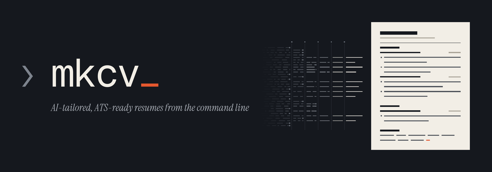

<p align="center"></p>

# mkcv

[](https://github.com/bkuberek/mkcv/actions/workflows/ci.yml)
[](https://github.com/bkuberek/mkcv/tags)
[](https://opensource.org/licenses/MIT)
[](https://www.python.org/downloads/)

AI-powered CLI tool that generates ATS-compliant PDF resumes tailored to specific job applications.

## What is mkcv?

mkcv takes your career knowledge base and a job description, then produces a polished, keyword-optimized resume through a 5-stage AI pipeline. Every resume is tailored to the specific role -- the AI analyzes requirements, selects the most relevant experience, rewrites bullets using the XYZ impact formula, and optimizes for applicant tracking systems.

## Features

- **5-stage AI pipeline** -- analyze JD, select experience, tailor content, structure YAML, review for ATS compliance
- **Multi-provider AI** -- Anthropic (Claude), OpenAI (GPT), Google (Gemini), and any OpenAI-compatible endpoint (Ollama, OpenRouter, Groq, ...)
- **Interactive mode** -- pause and review after each pipeline stage
- **Cover letters** -- generate tailored cover letters alongside your resume
- **Multiple themes** -- choose from built-in RenderCV themes (sb2nov, classic, moderncv, engineeringresumes)
- **PDF + more** -- render to PDF, PNG, Markdown, or HTML via Typst
- **Workspace model** -- organize knowledge base, config, and applications per company/role
- **Smart defaults** -- a recommended model for every stage, switchable with one flag (`--model-profile`), with warnings for weak or unknown models and `mkcv models` to see what each stage costs
- **Configurable** -- 5-layer config resolution (defaults, global, workspace, env vars, CLI flags)

## Quick Start

```bash
# Install (macOS on Apple silicon, or Linux)
brew install bkuberek/tap/mkcv

# Create a workspace. The first mkcv command you run also creates
# ~/.config/mkcv/settings.toml (private, mode 600) with a place for each API key
mkcv init ~/Documents/cv

# Put an API key (at least one provider) in your user config file
$EDITOR ~/.config/mkcv/settings.toml

# Edit your knowledge base with your career history
$EDITOR ~/Documents/cv/knowledge-base/career.md

# Generate a resume tailored to a job description
cd ~/Documents/cv
mkcv generate --jd https://example.com/job-posting.txt \
  --company Acme --position "Senior Engineer"
```

## Installation

### Homebrew (macOS on Apple silicon, Linux)

```bash
brew install bkuberek/tap/mkcv
```

Homebrew installs mkcv with its own Python 3.13, so nothing else is required.
Update it with `brew update && brew upgrade mkcv`. The formula installs binary
wheels only, so it needs network access to PyPI. It does not support Intel
Macs, because a dependency (`cryptography`) no longer publishes macOS x86_64
wheels; use `uv` or `pipx` there.

The other methods require **Python 3.12+**.

### pip

```bash
pip install git+https://github.com/bkuberek/mkcv.git
```

### pipx (isolated environment)

```bash
pipx install git+https://github.com/bkuberek/mkcv.git
```

### uv

```bash
uv tool install git+https://github.com/bkuberek/mkcv.git
```

### From source

```bash
git clone https://github.com/bkuberek/mkcv.git
cd mkcv
uv sync
uv run mkcv --help
```

Verify the installation:

```bash
mkcv --version
mkcv --help
```

## Usage

### Set Up API Credentials

mkcv needs at least one AI provider configured. The first time you run any mkcv
command, it creates your user config file, `~/.config/mkcv/settings.toml`, with
mode 600 and a commented template, and prints one line to say so. The file
applies to every workspace, keeps keys out of your repositories and shell
environment, and survives upgrades. Open it and fill in the key of each
provider you use:

```toml
# Anthropic (default provider -- recommended)
[default.providers.anthropic]
api_key = "sk-ant-..."

# OpenAI
[default.providers.openai]
api_key = "sk-..."

# Google Gemini
[default.providers.google]
api_key = "..."

# OpenRouter (access 200+ models with one key)
[default.providers.openrouter]
api_key = "sk-or-..."
```

Leave the providers you do not use as `api_key = ""`; an empty key counts as not
set, so mkcv falls back to the provider's environment variable. mkcv never
changes a file that already has content. If the file is missing or empty it is
created or filled; set `MKCV_NO_USER_CONFIG=1` to stop that (for CI, tests, or
packaging). If mkcv cannot write the file, it carries on without it.
Never put `api_key` in a workspace `mkcv.toml` that you commit to git.

Environment variables (`ANTHROPIC_API_KEY`, `OPENAI_API_KEY`, `GEMINI_API_KEY`,
`OPENROUTER_API_KEY`, or `MKCV_PROVIDERS__<NAME>__API_KEY`) also work and suit CI
and one-off overrides. A key in config takes precedence over the environment
variable. Details: [docs/models.md](docs/models.md#api-keys).

Two providers need no key:

- **Google Gemini via Vertex AI + Application Default Credentials:** run
  `gcloud auth application-default login`, then in `mkcv.toml` set
  `[default.providers.google]` with `vertexai = true` and
  `project = "my-gcp-project"`.
- **Ollama** (free, local): just have Ollama running.

### Create a Workspace

```bash
mkcv init ~/Documents/cv
```

This creates an organized directory with your knowledge base, config, and a place for generated applications:

```
~/Documents/cv/
├── mkcv.toml                    # Workspace configuration
├── knowledge-base/
│   ├── career.md                # Your career history (fill this in!)
│   └── voice.md                 # Writing tone/style guidelines
├── applications/                # Generated resumes go here
└── templates/                   # Custom prompt overrides
```

### Generate a Resume

```bash
# Basic -- from a file
mkcv generate --jd job_description.txt --kb career.md

# From a URL
mkcv generate --jd https://example.com/posting.txt --kb career.md

# From clipboard (macOS)
pbpaste | mkcv generate --jd - --kb career.md

# Workspace mode (KB from config, organized by company)
cd ~/Documents/cv
mkcv generate --jd job.txt --company DeepL --position "Senior Engineer"

# Interactive mode -- review each stage before proceeding
mkcv generate --jd job.txt --kb career.md --interactive

# Run every stage on another provider's recommended models
mkcv generate --jd job.txt --kb career.md --model-profile openai
mkcv generate --jd job.txt --kb career.md --model-profile google-economy

# Free local Ollama models
mkcv generate --jd job.txt --kb career.md --model-profile local

# Resume from a specific stage (reuse previous artifacts)
mkcv generate --jd job.txt --from-stage 3

# Skip PDF rendering
mkcv generate --jd job.txt --kb career.md --no-render
```

**Pipeline stages:**
1. **Analyze JD** -- extract requirements, keywords, and priorities
2. **Select Experience** -- choose the most relevant items from your knowledge base
3. **Tailor Content** -- rewrite bullets with XYZ formula, weave in keywords
4. **Structure YAML** -- produce RenderCV-compatible YAML
5. **Review** -- ATS compliance check with scoring and suggestions

### Generate a Cover Letter

```bash
# From a job description and resume
mkcv cover-letter --jd job.txt --company Acme --position "Senior Engineer"

# Using an existing application directory
mkcv cover-letter --jd job.txt --app-dir applications/acme/senior-engineer/2025-01-15
```

### Render to PDF

```bash
mkcv render resume.yaml
mkcv render resume.yaml --theme classic
mkcv render resume.yaml --format pdf,png,md,html
mkcv render resume.yaml --open    # Open PDF after rendering
```

### Validate Quality

```bash
# Validate a resume YAML (LLM-powered ATS check)
mkcv validate resume.yaml

# Validate against a specific JD for keyword coverage
mkcv validate resume.yaml --jd job.txt

# Validate knowledge base structure (no LLM needed)
mkcv validate --kb knowledge-base/career.md
```

### Browse Themes

```bash
mkcv themes                      # List all available themes
mkcv themes --preview sb2nov     # Detailed theme preview
```

### Workspace Status

```bash
mkcv status                      # Overview of workspace and applications
```

### Models and Costs

```bash
mkcv models                              # The model, tier, and estimated cost of every stage
mkcv models --model-profile openai       # What the openai profile would use
mkcv models --profiles                   # List the built-in model profiles
mkcv models --catalog --provider google  # What mkcv knows about each Gemini model
mkcv models --json                       # Machine-readable output
```

`mkcv generate` and `mkcv cover-letter` print the same warnings before they
run when a stage uses a weak or unknown model, or when a provider's API key is
missing. Model warnings never stop a run; a missing API key does (exit code 3).

## Configuration

Configuration is resolved in 5 layers (later overrides earlier):

1. **Built-in defaults** -- bundled with the package
2. **Global user config** -- `~/.config/mkcv/settings.toml`
3. **Workspace config** -- `mkcv.toml` in workspace root
4. **Environment variables** -- `MKCV_` prefix
5. **CLI flags** -- applied at runtime

Any option can live in either file: put what applies everywhere in the user
config (`~/.config/mkcv/settings.toml`) and what is specific to one workspace in
its `mkcv.toml`, which overrides the user config. Both files start with the same
commented list of options (`mkcv init` writes the workspace one, and an empty
`mkcv.toml` is filled the same way). See [`examples/mkcv.toml`](examples/mkcv.toml)
for a fully-commented configuration reference.

### Model Profiles

A model profile names one recommended model per stage on one provider. Pick one
with `--model-profile`, or set a default in `mkcv.toml`:

| Profile | Provider | Best for |
|---------|----------|----------|
| `anthropic` (default) | Anthropic | Haiku for extraction, Opus for decisions and writing, Sonnet for YAML |
| `anthropic-economy` | Anthropic | Haiku for every resume stage |
| `openai` | OpenAI | Luna, Astra, Sol, and Terra mix |
| `openai-economy` | OpenAI | Low-cost Luna and Terra |
| `google` | Google | Flash-Lite, Argon, and Flash mix |
| `google-economy` | Google | Low-cost Flash-Lite and Flash |
| `local` | Ollama | Free and offline, lowest quality |

```toml
[default.pipeline]
model_profile = "google"
```

`--provider openai` runs every stage on that provider's recommended models,
like `--model-profile openai`; it also works for providers with no profile if
`mkcv.toml` names a model for each stage. `--preset concise` selects the
economy variant of the profile. **The profiles are provisional**: they follow
vendor positioning and prices, not measurements of mkcv's pipeline. See
[docs/models.md](docs/models.md) for the tables, precedence rules, and the
facts behind them.

The legacy `--profile budget|premium` flag still works but is deprecated; use
`--preset` and `--model-profile`.

### Per-Stage Configuration

Choose the provider and model for any stage in `mkcv.toml`. A stage you
configure beats the profile:

```toml
[default.pipeline.stages.tailor]
provider = "openai"
model = "gpt-6-astra"

[default.pipeline.stages.structure]
model = "gemini-3.8-flash"        # provider inferred from the model

[default.cover_letter.stages.generate]
provider = "anthropic"
model = "claude-opus-5-5"
temperature = 0.6
```

Section headers in `mkcv.toml` need the `default.` prefix; without it the
setting is ignored. Per-stage settings are now honoured by `mkcv generate`:
earlier versions replaced them with the preset's models. Check the result with
`mkcv models`.

Claude 5.x, GPT-5/6, and Gemini models do not accept sampling parameters, so
mkcv omits `temperature` for them. It still applies to Claude 4.x and to
OpenAI-compatible endpoints.

### Environment Variables

Use the `MKCV_` prefix with double underscores for nested keys:

```bash
export MKCV_RENDERING__THEME=classic
export MKCV_PIPELINE__MODEL_PROFILE=google
export MKCV_PIPELINE__STAGES__ANALYZE__MODEL=claude-sonnet-5-5
```

## LLM Providers

| Provider | Setup | Notes |
|----------|-------|-------|
| **Anthropic** | `api_key` in `~/.config/mkcv/settings.toml` (or `ANTHROPIC_API_KEY`) | Default provider, Claude models |
| **OpenAI** | `api_key` in `~/.config/mkcv/settings.toml` (or `OPENAI_API_KEY`) | GPT models, strict structured output |
| **Google Gemini** | `api_key` in `~/.config/mkcv/settings.toml` (or `GEMINI_API_KEY` / `GOOGLE_API_KEY`), or Vertex AI with ADC (below) | Gemini models |
| **Ollama** | [Install Ollama](https://ollama.ai), run `ollama serve` | Free, local, no API key |
| **OpenRouter** | `api_key` in `~/.config/mkcv/settings.toml` (or `OPENROUTER_API_KEY`) | 200+ models via single API key; name a model per stage |
| **Any OpenAI-compatible endpoint** | Define it in `mkcv.toml` | Groq, Together, vLLM, LM Studio, a company gateway |

If your Google organization disallows API keys, use Vertex AI with Application
Default Credentials. Log in once with `gcloud auth application-default login`,
then add this to `mkcv.toml`:

```toml
[default.providers.google]
vertexai = true
project = "my-gcp-project"
location = "global"
```

`GOOGLE_GENAI_USE_VERTEXAI`, `GOOGLE_CLOUD_PROJECT`, and `GOOGLE_CLOUD_LOCATION`
work too; config wins. With several Google accounts, pin a credentials file with
`credentials_file = "~/.config/gcloud-mkcv/application_default_credentials.json"`.
See [docs/models.md](docs/models.md#google-gemini-on-vertex-ai) for the multi-account recipe.

[OpenRouter](https://openrouter.ai) is a good choice if you want access to Claude, GPT, Gemini, DeepSeek, and more through a single API key. It has no model profile, so set `provider = "openrouter"` and an OpenRouter model identifier (for example `anthropic/claude-sonnet-4`) for each stage you run on it.

To use another OpenAI-compatible endpoint, define it as a provider:

```toml
[default.providers.groq]
type = "openai-compatible"
base_url = "https://api.groq.com/openai/v1"
api_key_env = "GROQ_API_KEY"

[default.pipeline.stages.analyze]
provider = "groq"
model = "llama-3.3-70b-versatile"
```

If mkcv does not know a model, it runs it with conservative defaults and a
warning; describe the model with a `[[default.model_catalog]]` entry to give
it a quality tier and prices. See [docs/models.md](docs/models.md).

Upgrading from 1.4? Per-stage config now applies to `generate`, a missing API
key stops the run, and `http://localhost:11434` is fixed to `/v1` for you. See
[Upgrading from 1.4](docs/models.md#upgrading-from-14).

## Contributing

Contributions are welcome! Please see [CONTRIBUTING.md](CONTRIBUTING.md) for guidelines on how to get started.

## License

This project is licensed under the MIT License. See the [LICENSE](LICENSE) file for details.

## Development

For detailed development setup, architecture documentation, and coding conventions, see [docs/DEVELOPMENT.md](docs/DEVELOPMENT.md).

## Built with AI

This project was built with the assistance of AI using [Spec-Driven Development (SDD)](https://github.com/Gentleman-Programming/agent-teams-lite), a structured workflow for planning and implementing features through proposal, spec, design, and task phases. Cross-session memory is powered by [Engram](https://github.com/Gentleman-Programming/engram), and code quality is enforced by [Clean Code skills](https://skills.sh/sickn33/antigravity-awesome-skills/clean-code).
